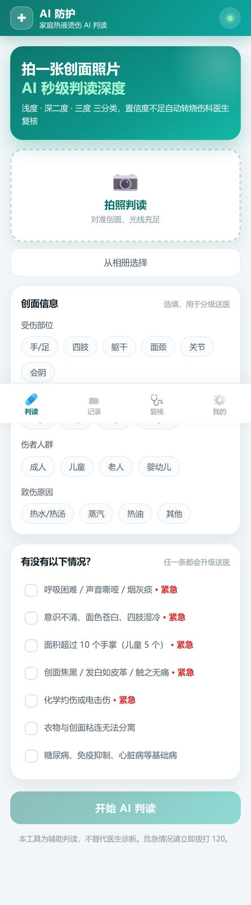
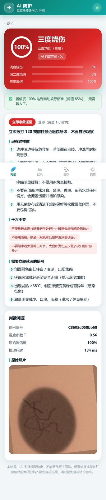
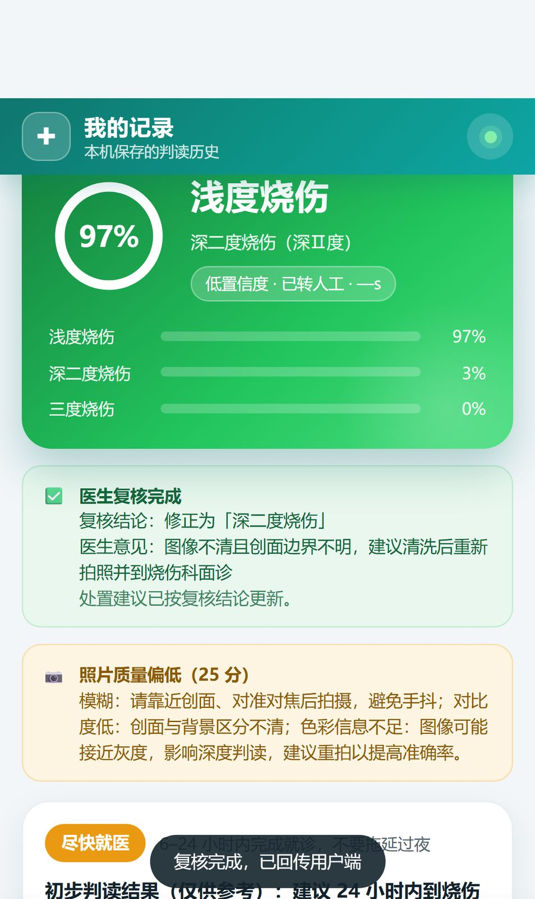
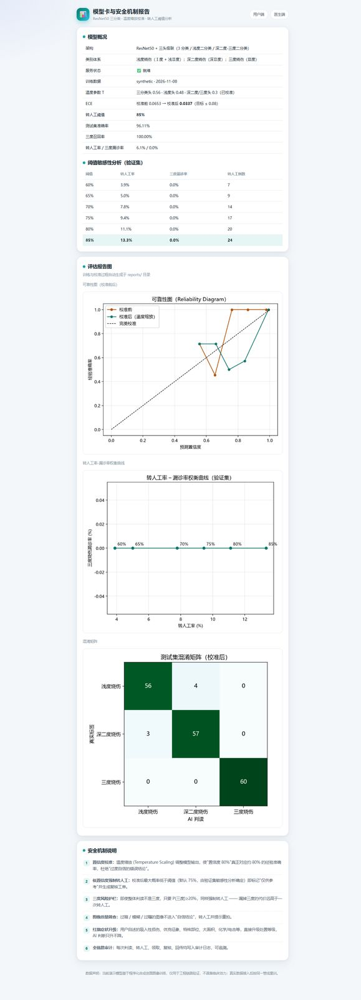

# AI 防护 —— 家庭热液烫伤深度三分类与低置信度转人工机制

面向家庭热液烫伤"黄金 1 小时"急救场景的 AI 辅助判读系统（大创项目工程实现）：

```
拍摄/上传 -> ResNet50 三分类 + 级联融合 -> 温度缩放校准 -> 置信度评估
   ├─ 置信度充足且无风险信号 -> 确定性结论 + 分级送医建议
   └─ 低置信度 / 三度风险 / 图像质量差 / 红旗症状 -> 强制转人工
            -> 复核工单(高优先级 SLA 30min) -> 医生端复核 -> 结论回传用户端
```

<p align="center">
  
  
  
  
</p>

> 左→右：手机 App 判读首页 / AI 判读结果（含分级处置）/ 医生复核结论回传 / 模型卡与阈值敏感性分析。


## 目录结构

```
burn-ai-guard/
├─ server/                 # Flask 后端
│  ├─ app.py               # REST API + 静态页面（用户端/医生端/模型卡/SUS）
│  ├─ engine.py            # 推理引擎：多头前向 -> 温度缩放 -> 级联融合 -> 转人工判定
│  ├─ net.py               # ResNet50 + 三头级联网络定义
│  ├─ advice.py            # 分级送医建议引擎（规则 + 红旗只升不降）
│  ├─ quality.py           # 图像质量筛查（模糊/过暗/过曝 -> 转人工并提示重拍）
│  ├─ db.py                # SQLite：病例/工单/复核/审计/SUS
│  └─ config.py            # 阈值、SLA、类别体系等配置
├─ ml/                     # 训练与校准管线
│  ├─ synth.py             # 合成创面数据生成器（bootstrap 演示集，1200 张）
│  ├─ data.py              # 数据集/分层划分/标签映射（真实数据集同接口接入）
│  ├─ train.py             # ResNet50 两阶段训练（冻结特征缓存 -> 全网络微调）
│  ├─ calibrate.py         # 温度缩放、ECE、可靠性图、阈值敏感性分析、权衡曲线
│  └─ build_demo_model.py  # 一键构建演示模型
├─ frontend/               # Web 端（与小程序同源 API）
│  ├─ index.html           # 用户端：上传 -> 判读 -> 置信度/转人工 -> 送医建议
│  ├─ doctor.html          # 医生端：工单列表 -> 领取 -> 复核 -> 回传
│  ├─ model.html           # 模型卡：指标/温度/ECE/阈值敏感性/报告图
│  ├─ sus.html             # SUS 可用性问卷（目标 ≥68 分）
│  └─ app/                 # 手机 App（可安装 PWA + APK 壳共用源）
│     ├─ index.html        # 底部四标签：判读 / 记录 / 复核 / 我的
│     ├─ manifest.webmanifest / sw.js   # PWA 安装与离线外壳
│     └─ icons/            # 应用图标（tools/gen_icons.py 生成）
├─ tools/                  # 图标生成 / App UI 自测 / Android 资源修补
├─ apk/                    # Capacitor 工程（npm 依赖 + android/ 产物）
├─ build_android.sh        # 一次性安装 Android SDK 组件
├─ build_apk.sh            # 一键打包 APK
├─ miniprogram/            # 微信小程序原生原型（用户端 + 医生端），同源 API
├─ models/                 # burnnet_resnet50.pt + calibration.json（训练产物）
├─ reports/                # 可靠性图、权衡曲线、混淆矩阵、训练曲线
└─ data/                   # synthetic/ 演示数据集；真实数据集也放这里
```

## 快速开始

```bash
pip install -r requirements.txt        # torch 建议 CPU 版即可
python ml/build_demo_model.py          # 合成数据 -> 训练 -> 校准（一键）
python -m server.app                   # 启动（监听 0.0.0.0:5000，会打印局域网地址）
```

- 用户端：`http://127.0.0.1:5000/`（可点"示例图片"快速体验）
- 医生端：`http://127.0.0.1:5000/doctor`（演示账号 `doctor / burn2026`）
- 模型卡：`http://127.0.0.1:5000/model`
- SUS 问卷：`http://127.0.0.1:5000/sus`
- 小程序：用微信开发者工具打开 `miniprogram/`，`config.js` 中把 BASE_URL 改成电脑局域网 IP

## 手机 App（两种形态）

### ① 安装版 Android APK

```bash
bash build_android.sh    # 一次性：下载 Android 命令行工具并安装 SDK 组件（约 1GB）
bash build_apk.sh        # 同步 Web 资源 -> Capacitor 工程 -> gradlew assembleDebug
```

产物：`apk/AI防护-烫伤判读-v1.0.apk`（debug 签名，直接传到手机安装）。

- 壳内本地资源 + 请求后端 API；默认服务地址写在 `apk/www/api-default.js`（构建脚本自动注入本机局域网 IP），App 内「我的」页可随时改
- 已允许明文 HTTP（局域网联调）、声明 CAMERA 权限（拍照判读）、替换了启动图标
- 重新打包只需再跑 `bash build_apk.sh`

### ② 免安装 PWA（iOS / 通用）

手机与电脑连同一 WiFi，浏览器打开启动横幅打印的 `http://<局域网IP>:5000/app`：

- Android Chrome / Edge：菜单 →「安装应用 / 添加到主屏幕」，获得独立图标与全屏启动
- iOS Safari：分享 →「添加到主屏幕」（需 HTTPS 环境才能离线缓存，局域网 http 下功能完整、仅无 Service Worker）
- 底部四标签：判读 / 记录 / 复核 / 我的；记录保存在本机，可点开回看病例
- App 自测：`python tools/ui_test_app.py`（Playwright iPhone 视口，覆盖上传→判读→记录→医生复核→设置）

## 安全机制（对应申请书创新点 3.2 / 3.3）

| 机制 | 触发条件 | 行为 |
|---|---|---|
| 低置信度强制转人工 | 校准后 max prob < 阈值（验证集敏感性分析确定） | 标记"仅供参考"，生成复核工单 |
| 三度风险护栏 | P(三度) ≥ 0.20 且 top1 ≠ 三度 | 转人工，避免高危漏诊 |
| 图像质量筛查 | 模糊/过暗/过曝（质量分 < 0.35） | 转人工 + 提示重拍 |
| 红旗症状升级 | 吸入性/休克/大面积/特殊部位/化学电击等 | 处置等级只升不降 |
| 全链路审计 | 每次判读/领取/复核/回传 | audit 表可追溯 |

## 真实数据接入

1. `Skin Burn Dataset`（约 1300 张，YOLO 标注）转换后按类别放入 `data/skin_burn/<class_key>/`；
2. 标签映射按 `ml/data.py:remap_yolo_labels`（Ⅰ度+浅Ⅱ度→浅度；深Ⅱ度→深二度；Ⅲ度→三度，歧义样本由医学顾问裁定）；
3. 运行 `python ml/train.py --data data/skin_burn --epochs1 20 --epochs2 30`（GPU 建议），再 `python ml/calibrate.py --data data/skin_burn`；
4. 重启服务即自动加载新权重与校准参数。

## 指标目标对照（申请书预期成果）

- 整体准确率 ≥ 80%、三度召回 ≥ 85%、各类 F1 ≥ 0.75 → 见 `/model` 页面实时展示
- 校准后 ECE ≤ 0.08 → calibration.json
- 推理 ≤ 5 秒/张 → 实测 CPU 单张 ~0.1s
- 用户端核心流程 ≤ 5 步、医生端复核 ≤ 3 步 → 前端已按此设计
- SUS ≥ 68 分 → `/sus` 自动统计

> ⚠️ 当前 demo 模型由程序化合成创面图像训练，仅验证工程链路，**不具临床效力**；
> 真实标注数据到位后按上述管线重训。
